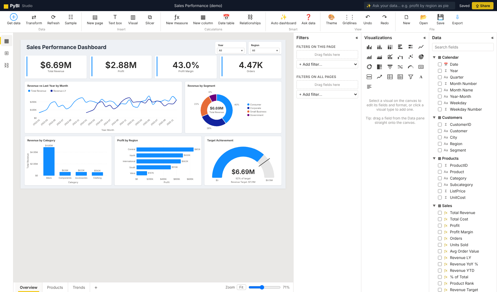
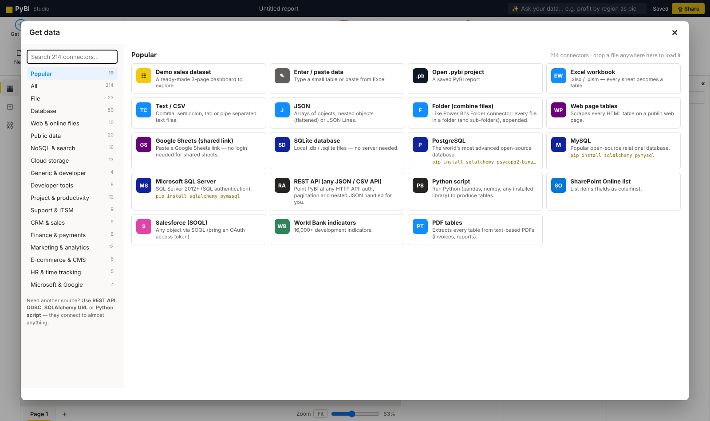
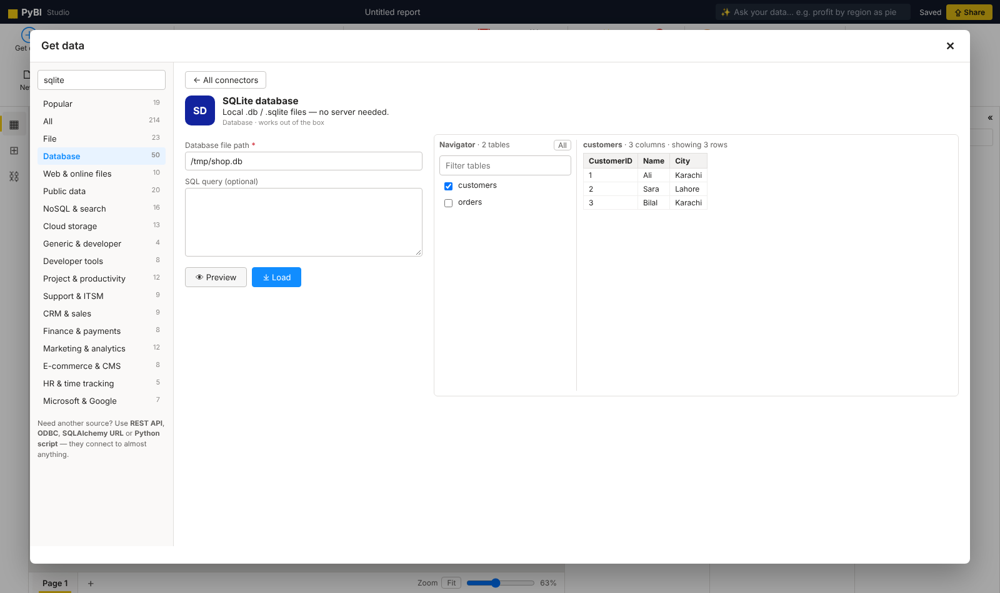
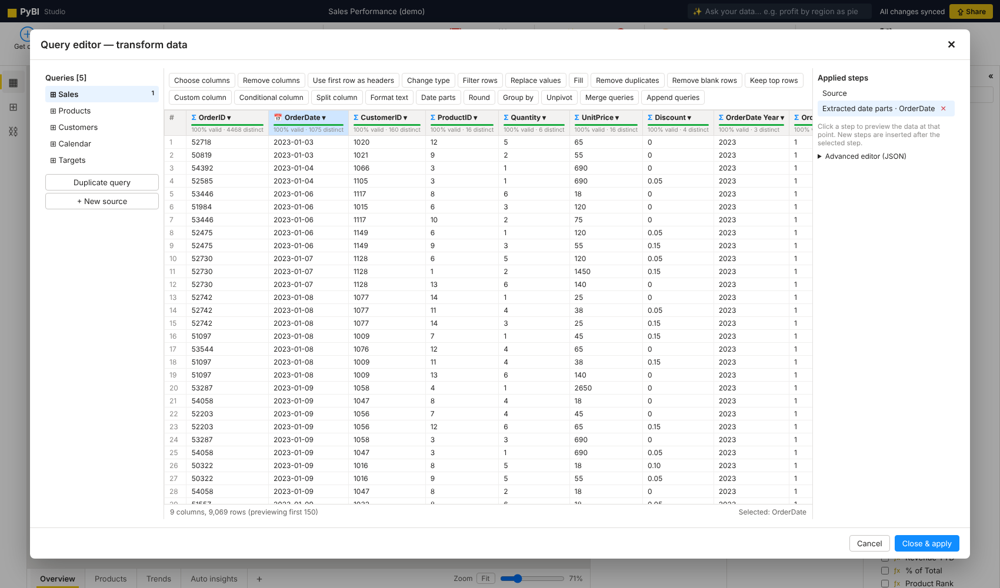
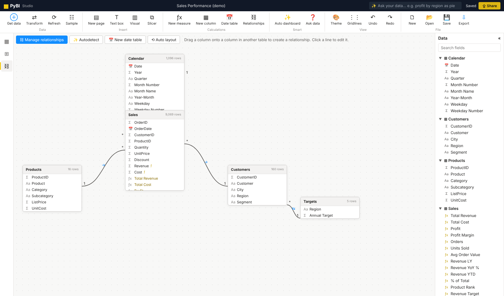

# PyBI — Business Intelligence in Python

[](https://pypi.org/project/pybi-ray/) [](https://github.com/rafay183/pybi/actions/workflows/ci.yml) [](https://pypi.org/project/pybi-ray/) [](LICENSE) [](CONTRIBUTING.md)

> Install name: **`pybi-ray`** · command: **`pybi`** · import: **`import pybi`**

**PyBI** is an open-source, Power BI–style business intelligence studio that you install with `pip` and run on your own computer. Connect data, shape it with a visual query editor, build a star-schema model, write DAX-style measures, design interactive dashboards, share a live link on your network, and export to PNG, PowerPoint, PDF or a self-contained interactive HTML file.

```bash
pip install pybi-ray
pybi run          # opens PyBI Studio at http://127.0.0.1:8050
pybi demo         # opens with a ready-made 3-page sales dashboard
```

Created by **Muhammad Rafay Shaikh, from Pakistan**.



<details><summary><b>More screenshots</b></summary>

| Get data (214 connectors) | Navigator & preview |
|---|---|
|  |  |
| **Query editor** | **Model view** |
|  |  |

</details>

---

## Features

| Area | What you get |
|---|---|
| **Get data** | **214 connectors**: files (Excel, CSV, JSON, XML, Parquet, PDF tables, SAS/SPSS/Stata…), 50 databases (SQL Server, PostgreSQL, MySQL, Oracle, Snowflake, BigQuery, Databricks…), NoSQL, cloud storage (S3, Azure, GCS, SFTP), 70+ SaaS apps (Salesforce, HubSpot, Stripe, Shopify, Jira, Notion…), public data (World Bank, FRED, Eurostat…), REST/GraphQL/OData/Python — with preview, navigator and refresh |
| **Query editor** (Power Query style) | Applied steps with live preview and column quality bars: choose/remove columns, promote headers, change type, filter rows, replace values, fill up/down, remove duplicates/blanks, keep top rows, custom column, conditional column, split column, text formatting, date parts, round, group by, unpivot, merge queries, append queries, plus a JSON advanced editor |
| **Model view** | Drag-and-drop relationships, many-to-one with single or **both** cross-filter direction, active/inactive, autodetect, one-click date table |
| **DAX-style formulas** | Measures and calculated columns with `VAR … RETURN`, `CALCULATE`, `FILTER`, `ALL`, `ALLEXCEPT`, `ALLSELECTED`, `REMOVEFILTERS`, `KEEPFILTERS`, `VALUES`, `SELECTEDVALUE`, `RELATED`, `RELATEDTABLE`, `LOOKUPVALUE`, iterators (`SUMX`, `AVERAGEX`, `RANKX`, `TOPN`, `CONCATENATEX`), time intelligence (`TOTALYTD`, `DATESYTD`, `SAMEPERIODLASTYEAR`, `DATEADD`, `PARALLELPERIOD`, `PREVIOUSMONTH`, `DATESBETWEEN`, …), logic, math, text and date functions |
| **Visuals (25)** | Clustered / stacked / 100% column and bar, line, area, stacked area, line & column combo, waterfall, ribbon, scatter / bubble, pie, donut, treemap, funnel, gauge, card, multi-row card, KPI, table (with data bars), matrix (expand/collapse, subtotals), slicers (list, dropdown, tiles, range), text box, smart narrative |
| **Interactivity** | Cross-filtering by clicking any chart (Ctrl+click for multi-select), slicers (optionally synced across pages), visual / page / report filters (basic, advanced, range), tooltips, focus mode, export data behind a visual |
| **Report design** | Drag, resize, snap & alignment guides, pages, page sizes, 6 themes (including dark), per-visual formatting, undo/redo, copy/paste, keyboard nudging |
| **Smart features** | **Ask your data** (type "top 5 products by profit as bar"), **Auto dashboard** (builds a full insight page from your model), **Smart narrative** (auto-written summary) |
| **Share** | Live, read-only network link (`/view`) for anyone on your Wi-Fi/LAN that refreshes as you edit; editing stays on your machine |
| **Export** | PNG (page or all pages), PowerPoint `.pptx`, PDF, **interactive HTML** (one offline file with data, slicers and cross-filtering), `.pybi` project file, CSV/Excel of any table |

## Connectors (214)

Open **Get data** to search the catalog. Each connector shows a form, a live preview, and (for databases, workbooks, folders, buckets) a **Navigator** to pick tables. Loaded sources remember how they were connected, so **Refresh** re-pulls fresh data while keeping your query steps. Passwords and tokens are stored only on your computer in `~/.pybi/credentials.json` — never inside `.pybi` files.

Connectors marked † need an extra driver (`pip install …` — PyBI tells you the exact command).

**File (23)** — Text / CSV, Tab-separated (TSV), Fixed-width text, Excel workbook, Excel 97-2003 (.xls) †, Excel binary (.xlsb) †, OpenDocument spreadsheet †, JSON, JSON Lines / NDJSON, XML, HTML file, Parquet †, Feather / Arrow IPC †, ORC †, Avro †, SAS (.sas7bdat / .xpt), SPSS (.sav) †, Stata (.dta), HDF5 †, YAML, PDF tables, ZIP archive, Folder (combine files)

**Database (50)** — SQLite database, PostgreSQL †, TimescaleDB †, Greenplum †, YugabyteDB †, Supabase (Postgres) †, Neon (serverless Postgres) †, Google Cloud SQL for PostgreSQL †, Amazon Aurora / RDS PostgreSQL †, Azure Database for PostgreSQL †, Google AlloyDB †, MySQL †, MariaDB †, PlanetScale †, TiDB †, Google Cloud SQL for MySQL †, Amazon Aurora / RDS MySQL †, Azure Database for MySQL †, Microsoft SQL Server †, Azure SQL Database †, Azure Synapse Analytics (SQL) †, Microsoft Fabric Warehouse (SQL endpoint) †, Oracle Database †, IBM Db2 †, SAP HANA †, Teradata †, Vertica †, CockroachDB †, SingleStore †, Exasol †, Firebird †, ClickHouse †, Trino †, Presto †, Apache Hive †, Spark SQL (Thrift server) †, Apache Impala †, Apache Druid †, Apache Pinot †, Dremio †, Snowflake †, Amazon Redshift †, Google BigQuery †, Amazon Athena †, Databricks SQL †, DuckDB †, MotherDuck †, Microsoft Access †, ODBC (any driver) †, Other SQL database (SQLAlchemy URL) †

**Web & online files (10)** — Web page tables, Wikipedia tables, File from URL, Google Sheets (shared link), Google Drive file, OneDrive / SharePoint file link, Dropbox file, GitHub file, Hugging Face dataset file, RSS feed

**Public data (20)** — Our World in Data, World Bank indicators, FRED economic data, CoinGecko crypto markets, CoinGecko price history, Open-Meteo weather history, REST Countries, Exchange rates (ECB), Alpha Vantage stocks, Yahoo Finance †, US Census Bureau, Socrata open data (SODA), CKAN open data (data.gov…), Eurostat, OECD data (SDMX), IMF DataMapper, USGS earthquakes, NASA POWER climate, Kaggle dataset †, Hacker News top stories

**NoSQL & search (16)** — MongoDB †, Amazon DocumentDB †, Elasticsearch, OpenSearch, Apache Solr, Apache CouchDB, InfluxDB 2.x / Cloud, Prometheus, Redis †, Apache Cassandra / ScyllaDB †, Amazon DynamoDB †, Google Firestore †, Firebase Realtime Database, Azure Cosmos DB (NoSQL) †, Neo4j (Cypher), Supabase (REST API)

**Cloud storage (13)** — Amazon S3 †, MinIO †, Cloudflare R2 †, Wasabi †, DigitalOcean Spaces †, Backblaze B2 (S3 API) †, Google Cloud Storage †, Azure Blob Storage †, Azure Data Lake Storage Gen2 †, SFTP †, FTP / FTPS, WebDAV / Nextcloud †, Hadoop HDFS †

**Generic & developer (4)** — REST API (any JSON / CSV API), GraphQL API, OData feed, Python script

**Developer tools (8)** — GitHub, GitLab, Bitbucket Cloud, Azure DevOps, Linear, Sentry, Datadog metrics, Grafana (dashboards list)

**Project & productivity (12)** — Jira Cloud, Confluence Cloud, Trello, Asana, ClickUp, monday.com, Notion database, Airtable, Smartsheet, Coda, Baserow, Slack

**Support & ITSM (9)** — PagerDuty, Zendesk Support, Freshdesk, Freshservice, Intercom, ServiceNow, Help Scout, Okta users, Twilio messages

**CRM & sales (9)** — Salesforce (SOQL), HubSpot, Pipedrive, Zoho CRM, Freshsales, Close CRM, Copper CRM, Dynamics 365 / Dataverse, ActiveCampaign

**Finance & payments (8)** — Stripe, PayPal transactions, Square, Xero, QuickBooks Online, Chargebee, Paddle Billing, Lemon Squeezy

**Marketing & analytics (12)** — Google Analytics 4, YouTube channel videos, Meta (Facebook) Ads insights, Mailchimp, Klaviyo, SendGrid stats, Brevo (Sendinblue), Typeform responses, SurveyMonkey, Jotform, Eventbrite, Calendly

**E-commerce & CMS (8)** — Webflow CMS, Shopify, WooCommerce, BigCommerce, WordPress, Contentful, Strapi, Gumroad sales

**HR & time tracking (5)** — BambooHR, Greenhouse, Harvest, Toggl Track, Clockify

**Microsoft & Google (7)** — Microsoft Graph (any endpoint), SharePoint Online list, Dynamics 365 Business Central, Microsoft Planner tasks, Google Sheets (API), Google Calendar, Google Search Console


Missing something? Four universal connectors reach almost anything: **REST API** (auth + 6 pagination styles + nested JSON flattening), **GraphQL**, **ODBC / SQLAlchemy URL**, and **Python script**.

> SaaS connectors use the vendor's public REST API with a token you provide (PyBI does not run OAuth sign-in flows yet). They were built from each vendor's API documentation and tested against a mock API, not against live accounts — if a vendor changes an endpoint, override it under *Advanced options* (endpoint, records path, query parameters) and please open an issue.

Install drivers in bulk with extras, e.g. `pip install "pybi-ray[postgres,mysql,cloud]"` or `pip install "pybi-ray[all]"`.

## Usage

```bash
pybi run                      # start the studio (network view link enabled)
pybi run sales.xlsx           # start with a data file loaded
pybi run my_report.pybi       # open a saved project
pybi run --private            # only this computer can connect
pybi run --port 9000 --no-browser
pybi demo                     # demo dataset + dashboard
pybi export my_report.pybi -o dashboard.html   # headless export to interactive HTML
python -m pybi run            # same as `pybi run`
```

From Python or Jupyter:

```python
import pandas as pd
import pybi

sales = pd.read_csv("sales.csv")
products = pd.read_excel("products.xlsx")
pybi.run(Sales=sales, Products=products)   # opens the studio with these tables
```

### Example measures

```text
Total Revenue  = SUM(Sales[Revenue])
Profit Margin  = DIVIDE([Profit], [Total Revenue])
Revenue LY     = CALCULATE([Total Revenue], SAMEPERIODLASTYEAR('Calendar'[Date]))
Revenue YTD    = TOTALYTD([Total Revenue], 'Calendar'[Date])
% of Total     = DIVIDE([Total Revenue], CALCULATE([Total Revenue], ALLSELECTED(Sales)))
Product Rank   = RANKX(ALL(Products), [Total Revenue])
Big Orders     = CALCULATE([Orders], Sales[Quantity] >= 3)
```

Calculated column:

```text
Sales[Cost] = Sales[Quantity] * RELATED(Products[UnitCost])
```

## How it works

* **Python** (Flask + pandas) serves the studio, loads and transforms data (query steps are replayable and stored in the project), saves `.pybi` projects (a zip of raw data, steps and the report definition), and builds PPTX/PDF/HTML exports.
* The **analytics engine** (filter context, relationships, the DAX-style language) and the **d3-based visuals** run in the browser, so the studio, the network view and exported HTML files behave identically.
* An autosave of the current project is kept in `~/.pybi/autosave.pybi`.

## Security notes

* The studio binds to all network interfaces so the `/view` link works on your LAN. Requests from **other computers can only view** (`/view`, read-only data); all editing APIs are restricted to the local machine. Use `--private` to disable network access completely.
* The custom-column step in the query editor evaluates pandas expressions. Only open `.pybi` files from people you trust.

## Limitations (v0.1)

PyBI is not a Microsoft product and does not open `.pbix` files. Data is held in memory, which works well up to a few million rows depending on your machine. Not every DAX function is implemented; unsupported functions show a clear error in the formula editor.

## Contributing

PyBI is built in the open and contributions are very welcome — connectors tested with real accounts, visuals, DAX functions, docs and translations.

* Read **[CONTRIBUTING.md](CONTRIBUTING.md)** for setup, project structure and how to add connectors/visuals.
* Look for issues labelled **good first issue**.
* Questions and ideas: **[Discussions](https://github.com/rafay183/pybi/discussions)**.

```bash
git clone https://github.com/rafay183/pybi
cd pybi
pip install -e ".[dev]"
pytest -q
pybi demo
```

Maintainers: release steps are in [docs/PUBLISHING.md](docs/PUBLISHING.md). See also [CHANGELOG.md](CHANGELOG.md) and [SECURITY.md](SECURITY.md).

## License

MIT © Muhammad Rafay Shaikh. Bundles [d3](https://d3js.org) (ISC license, © Mike Bostock).
